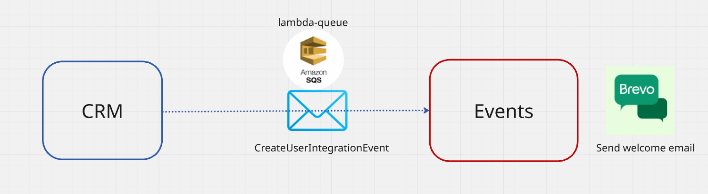
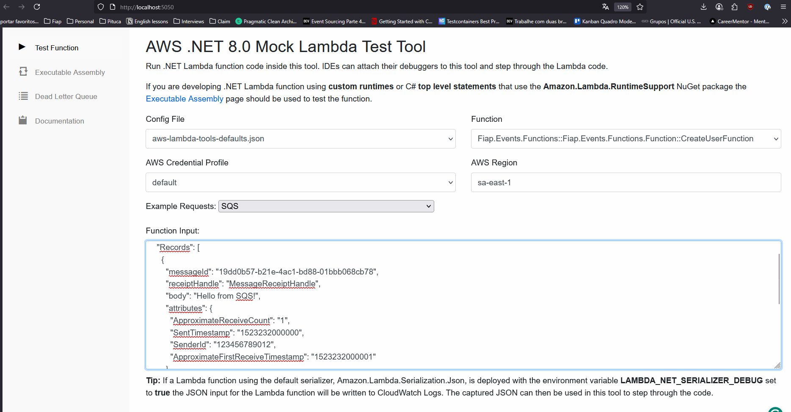
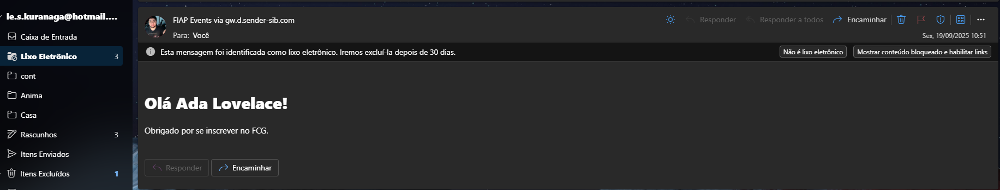
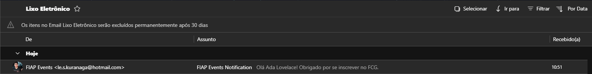
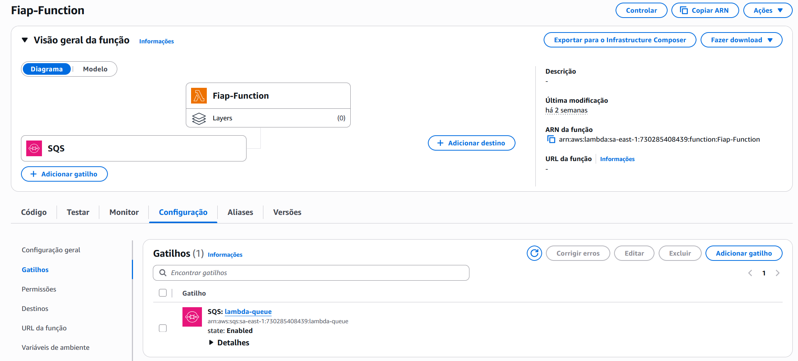

# Fiap Events - Sistema de Notificação por Email

Sistema de processamento de eventos baseado em AWS Lambda que recebe mensagens do CRM via SQS e envia emails de boas-vindas aos usuários criados.

## Arquitetura do Sistema

O projeto segue uma arquitetura em camadas:
- **Function Layer**: Ponto de entrada AWS Lambda
- **Application Layer**: Lógica de negócio e serviços
- **Infrastructure Layer**: Integrações externas (email, repositórios)
- **Tests Layer**: Testes unitários organizados por camada

### Fluxo de Eventos
1. Sistema CRM cria usuário e envia evento para fila SQS `lambda-queue`
2. AWS Lambda é acionada automaticamente pelo trigger SQS
3. Function deserializa a mensagem (suporta múltiplos formatos)
4. Mapeia evento para modelo CreateAccount
5. EventService utiliza EmailService para envio do email de boas-vindas

## Tecnologias Utilizadas
- .NET 8
- AWS Lambda
- Amazon SQS
- AWS Systems Manager (configurações)
- xUnit (testes)
- GitHub Actions (CI/CD)

## Build & Tests
| CI | Status |
| --- | --- |
| Validação PR| [](https://github.com/leandrokuranaga/Fiap-Events/actions/workflows/validate-release-pr.yml)
| Validação PR Main e Dev | [](https://github.com/leandrokuranaga/Fiap-Events/actions/workflows/validate-pr.yml)
| Release | [](https://github.com/leandrokuranaga/Fiap-Events/actions/workflows/release.yml)


## Deployment
| CD | Status |
| --- | --- | 
| AWS | [](https://github.com/leandrokuranaga/Fiap-Events/actions/workflows/deploy-aws.yml) | 


## Como Executar o Sistema

### Pré-requisitos para Desenvolvimento Local

Para testar a function localmente é necessário:

1. **Instalar AWS CLI**: [Download aqui](https://docs.aws.amazon.com/cli/latest/userguide/getting-started-install.html)
2. **Instalar AWS Toolkit**: [AWS Toolkit for Visual Studio](https://marketplace.visualstudio.com/items?itemName=AmazonWebServices.AWSToolkitforVisualStudio2022)
3. **Configurar credenciais AWS** com usuário IAM (região: sa-east-1)



### Configuração AWS CLI

```bash
aws configure
```

Configure com:
- Access Key ID
- Secret Access Key
- Default region: `sa-east-1`
- Output format: `json`



### Executando Testes Locais

Ao executar o projeto, configure o request de exemplo como SQS. **Importante**: altere o email no payload para o seu email para receber o email de boas-vindas.

#### Payload de Exemplo para Testes

```json
{
  "Records": [
    {
      "messageId": "test-id-1",
      "receiptHandle": "abc",
      "body": "{\"UserId\":123,\"Name\":\"Ada Lovelace\",\"Email\":\"SEU_EMAIL@AQUI.com\",\"Type\":1,\"Active\":true}",
      "attributes": {
        "ApproximateReceiveCount": "1",
        "SentTimestamp": "1523232000000",
        "SenderId": "123456789012",
        "ApproximateFirstReceiveTimestamp": "1523232000001"
      },
      "messageAttributes": {},
      "md5OfBody": "7b270e59b47ff90a553787216d55d91d",
      "eventSource": "aws:sqs",
      "eventSourceARN": "arn:aws:sqs:sa-east-1:123456789012:lambda-queue",
      "awsRegion": "sa-east-1"
    }
  ]
}
```

## Comandos de Build

```bash

# Restaurar dependências
dotnet restore *.sln

# Build
dotnet build *.sln --no-restore --configuration Release

# Executar testes
dotnet test *.sln --no-build --configuration Release --verbosity normal
```

## Funcionalidades Implementadas

- ✅ Processamento de eventos SQS
- ✅ Deserialização de múltiplos formatos de mensagem (Rebus, Base64, JSON)
- ✅ Envio de emails de boas-vindas
- ✅ Logging estruturado
- ✅ Testes unitários por camada
- ✅ CI/CD com GitHub Actions
- ✅ Deploy automatizado AWS Lambda

## Exemplo de Email Recebido

Após executar a function com sucesso, você receberá um email de boas-vindas.

> **⚠️ Importante**: O email geralmente é direcionado para a pasta de spam/lixo eletrônico, verifique essa pasta caso não encontre na caixa de entrada.

### Conteúdo do Email


### Email na Caixa de Entrada


## Trigger


